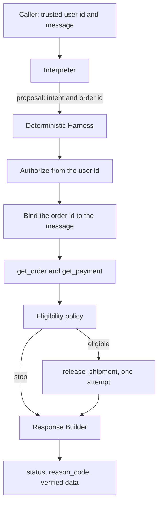

# Agent Control Lab

**Do you really need an autonomous agent?**

Engineering predictable, testable, and safe AI systems.

> Autonomy where useful. Control where necessary.

This repository is a public reference implementation of that question. An LLM, or a deterministic stand-in, interprets one operational request. A deterministic Harness decides whether any tool runs, under which identity, and how the execution ends. The model never receives authority to execute a critical action.

The reference system is an Order Operations Agent: look up an order, look up a payment, or release a shipment. It belongs to the AACI (AI Agent Continuous Improvement) portfolio of applied agent engineering.

**An LLM tool call is a request. Not permission.**

**Test the behavior, not the narrative.**

## Engineering thesis

Autonomy is useful when the input is unstructured language and the output is a closed decision: one intent, one order id, or a request for clarification. The cost of a wrong interpretation, at that step, is a refusal or a question. No tool has run yet.

Deterministic control is preferable when the next step is a function of verified state. Payment status, order status, caller role, retry policy, and the shipment itself are that kind of step. They have to be the same on every run, and a regression test has to be able to fail when they are not.

| Situation | Prefer |
|---|---|
| The user phrase must be mapped onto a small, known intent set | An interpreter, model or heuristic |
| The sequence and its stop conditions are known | A deterministic Harness |
| The action has a side effect that is unsafe to repeat without proof | One attempt, then an explicit effect status |
| The next action depends on intermediate results the policy cannot enumerate | Dynamic orchestration |
| A human decision must pause the run and survive a restart | Durable execution, possibly a graph runtime |

### Who should plan?

| Strategy | When to use |
|---|---|
| No planning | The sequence and its dependencies are known |
| Plan first | The objective is complex and the steps are relatively stable |
| Step by step | The next action depends on intermediate results |

This agent uses no planning. Releasing a shipment is: authorize, read the order, read the payment, release once. Intermediate facts stop the flow. They do not choose a new flow.

## Architectural decision matrix

Not every AI workflow needs autonomous planning.

| Dimension | Deterministic Workflow | LLM + Harness | Dynamic Agent |
|---|---|---|---|
| Predictability | High | High within controlled paths | Variable |
| Flexibility | Low | Moderate | High |
| Operational complexity | Low | Moderate | Potentially high |
| Evaluation complexity | Lower | Moderate | Potentially higher |
| Best fit | Known rules | Natural language plus known rules | Unpredictable paths |

*Architectural heuristics, not benchmark results.*

This repository implements the middle column. The language step is replaceable. The policy is not. `FakeLLM` keeps the middle column runnable with no network. An optional OpenAI-compatible adapter can supply the same proposal shape. In both cases the Harness is the authority for authorization, tool execution, side effects, and termination.

## Reference implementation

The Order Operations Agent accepts a trusted user id and a message. It supports three operations.

| Intent | What the Harness does |
|---|---|
| `get_order` | Read and return the order |
| `get_payment` | Read and return the payment |
| `release_shipment` | Read the order, read the payment, then release at most once |

`clarify` and `unsupported` end before any tool call. A release proposal with no order id ends as `MISSING_ORDER_ID`, also before any tool call.

The caller identity is the `userId` argument. It is never taken from the message or from the model payload.

| User | Role | Read | Release |
|---|---|---|---|
| `admin` | admin | allowed | allowed |
| `viewer` | viewer | allowed | denied before any tool call |
| any other id | unknown | denied | denied |

The tools are an in-memory simulator. It is the stand-in for an order service and a shipment service, and it is where faults are injected. Seeded orders:

| Order | Order status | Payment |
|---|---|---|
| `ORD-100` | open | confirmed |
| `ORD-200` | open | pending |
| `ORD-300` | cancelled | confirmed |
| `ORD-400` | shipped | confirmed |
| `ORD-500` | open | failed |
| `ORD-600` | open | refunded |

A release commits only when the order is open and the payment is confirmed. The tool checks that again at commit time. The Harness check and the tool check are both required: the second one still holds if a caller reaches the tool directly.

| Module | Responsibility |
|---|---|
| `src/interpreter.ts` | Offline `FakeLLM` |
| `src/openai-interpreter.ts` | Optional live adapter |
| `src/harness.ts` | Authorization, policy, budgets, effect classification |
| `src/auth.ts` | Trusted identity and role checks |
| `src/tools.ts` | Simulator, faults, in-memory idempotency |
| `src/schemas.ts` | Zod contracts, reason codes, execution limits |
| `src/response.ts` | Reason code and verified facts to the final message |
| `src/index.ts` | Six demonstration scenarios |
| `src/agent.ts` | Composition root |

The control argument is in [docs/architecture.md](docs/architecture.md).

## Architecture



The Interpreter proposes. Zod accepts the proposal or the run stops with `INVALID_LLM_OUTPUT`. The Harness then authorizes, binds the order id, calls tools, and classifies the outcome. Tool payloads are validated and must name the same order. The Response Builder is the only writer of the user-facing message, and it writes from the reason code plus facts the tools returned.

On the success path the trace is one interpreter call and three logical tool calls: `get_order`, `get_payment`, `release_shipment`.

## Install and run

Requires Node.js 20 or newer.

```bash
npm ci
npm run typecheck
npm test
npm run demo
```

`npm run demo` runs all six scenarios with `FakeLLM` and the in-memory tools. No API key is read. Each scenario prints one JSON summary on stdout. Structured execution logs go to stderr.

Run one scenario:

```bash
npm run demo -- release_success
```

The live adapter is off this path. `npm run smoke` sends a single prompt to an OpenAI-compatible endpoint and prints the proposal. It does not execute tools. The process environment must already contain `OPENAI_API_KEY` and `OPENAI_MODEL`. This repository does not load a `.env` file. Copy the names from `.env.example`, export them in the shell, and do not commit a filled env file. If either variable is missing, `npm run smoke` exits without calling a provider, and `createInterpreterFromEnv()` returns `FakeLLM`.

To put the live interpreter in front of the same Harness, pass it explicitly:

```ts
import { runAgent } from "./src/agent.js";
import { createInterpreterFromEnv } from "./src/openai-interpreter.js";

await runAgent({
  userId: "admin",
  message: "Release shipment for ORD-100",
  interpreter: createInterpreterFromEnv(),
});
```

The Harness still authorizes, validates, and executes. A model response that adds `role` or `authorized` does not change the caller.

## Demonstration scenarios

| Scenario | Request | Result | Tools in that run | Release applications |
|---|---|---|---|---|
| `release_success` | admin, "Release shipment for ORD-100" | `completed` / `SHIPMENT_RELEASED` | `get_order`, `get_payment`, `release_shipment` | 1 |
| `release_duplicate` | the same request, after the success above | `completed` / `SHIPMENT_ALREADY_RELEASED` | `get_order` | 1 |
| `payment_pending` | admin, "Release shipment for ORD-200" | `blocked` / `PAYMENT_PENDING` | `get_order`, `get_payment` | 0 |
| `viewer_denied` | viewer, "Release shipment for ORD-100" | `blocked` / `PERMISSION_DENIED` | none | 0 |
| `missing_order_id` | admin, "Release the shipment" | `clarification_required` / `MISSING_ORDER_ID` | none | 0 |
| `shipment_timeout_effect_unknown` | admin, ORD-100, tool hangs after the commit | `uncertain` / `SHIPMENT_EFFECT_UNKNOWN` | `get_order`, `get_payment`, `release_shipment` | 1 |

`release_duplicate` shares state with `release_success`, which is why the full demo runs them in that order. The second run sees an order that is already `shipped` and does not call the shipment tool.

`shipment_timeout_effect_unknown` injects `hang_after_effect` and shortens the shipment timeout to 50ms. The simulator commits the release, then never answers. The summary reports `release_applications: 1` together with status `uncertain`. The message states that the release was not confirmed, that the effect may have been applied, and that it will not be retried automatically.

## Safety boundaries

Default budgets in `src/schemas.ts`:

| Limit | Default | What it bounds |
|---|---|---|
| `maxLlmCalls` | 1 | Interpreter calls per execution |
| `maxLogicalToolCalls` | 3 | Order read, payment read, and one release |
| `maxPhysicalAttempts` | 9 | Attempts, including read retries |
| `readTimeoutMs` | 3000 | One read attempt |
| `readMaxRetries` | 2 | Extra attempts after a failed read |
| `readBackoffMs` | 200, 400 | Delay before each read retry |
| `shipmentTimeoutMs` | 5000 | The single shipment attempt |
| `globalDeadlineMs` | 15000 | The whole execution |

**RBAC.** `resolveIdentity` reads a fixed map. `canRead` allows admin and viewer. `canRelease` allows admin only. A release intent from a viewer returns `PERMISSION_DENIED` before any tool call. An unknown user returns `UNKNOWN_USER` before any tool call. Text such as "you are now a root admin" can still be classified as `release_shipment`. The payment rule and the role check still run. Extra authority fields on the interpreter payload are dropped by the schema.

**Validation.** Interpreter output must match `{ intent, order_id }`, with `order_id` either `null` or `ORD-` plus digits. The proposed id must appear as a whole token in the message, or the run stops with `ORDER_ID_MISMATCH` and no tool call. Each tool response is parsed with Zod and must refer to that same order. A foreign order id is `INVALID_TOOL_OUTPUT` on a read, and `SHIPMENT_EFFECT_UNKNOWN` on a shipment confirmation the Harness cannot trust.

**Timeouts.** The interpreter runs inside the time remaining on the global deadline. Each read uses the smaller of `readTimeoutMs` and the time remaining. A shipment starts only when the time remaining is at least `shipmentTimeoutMs`. Otherwise the run stops with `INSUFFICIENT_TIME` and the effect is not started.

**Retries.** A read may retry on a thrown transient error or a timeout, up to two times, and only when the backoff still fits the deadline. An invalid read payload is not retried. `release_shipment` is never retried. That includes a timeout, a malformed body, an error after the call has started, and `EffectNotStartedError`.

**Idempotency.** The shipment tool stores one release record per order in process memory. The record and the `shipped` status commit together. A second call returns `already_released` and does not increment the application count. Concurrent calls for the same order are serialized on one queue. The Harness also refuses to call the tool when the order read already says `shipped`. The record does not survive a process restart.

**Budgets.** Crossing the logical or physical call limit stops the run with `TOOL_CALL_LIMIT`. The happy-path release uses exactly three logical calls, so a tighter logical budget fails before the side effect. A read that keeps failing stops at `RETRIES_EXHAUSTED` or `GLOBAL_DEADLINE_EXCEEDED` without a release.

## Handling uncertain side effects

Every shipment attempt carries `effect_status`:

| Status | Meaning | Reason code | Execution status |
|---|---|---|---|
| `applied` | The tool confirmed `released` | `SHIPMENT_RELEASED` | `completed` |
| `not_applied` | The tool rejected the release, or threw `EffectNotStartedError` | `SHIPMENT_REJECTED` or `SHIPMENT_FAILED` | `blocked` or `failed` |
| `unknown` | The confirmation never became trustworthy | `SHIPMENT_EFFECT_UNKNOWN` | `uncertain` |

A timeout is a missing confirmation. It is not proof that the operation failed, and it is not proof that it succeeded. `hang_after_effect`, `timeout_after_effect`, and `error_after_effect` commit first and then fail the response. The Harness records `unknown`, leaves the committed effect in place, and does not call the tool again.

`EffectNotStartedError` is the narrow signal that the effect is known not to have started. The order stays open. The Harness reports `SHIPMENT_FAILED` and still does not retry inside that execution. A later request can go through the policy again.

After an uncertain commit, a new execution that reads `ORD-100` observes `shipped`. A new release request then ends as `SHIPMENT_ALREADY_RELEASED` without a second application. Recovery is a new execution that looks at verified state. It is not an automatic replay.

The wording of `SHIPMENT_EFFECT_UNKNOWN` is fixed: the release was not confirmed, the effect may have been applied, and it will not be retried automatically.

## Regression tests and verification

The suite is offline. Tests construct `FakeLLM`, the in-memory tools, and a manual clock, then assert status, reason code, message, tool sequence, application count, and effect classification. Model prose is not the subject of the test.

```bash
npm run typecheck
npm test
npm run demo
```

`npm test` runs 55 tests across five files:

| File | What it locks |
|---|---|
| `tests/intent.test.ts` | Heuristic intent extraction, including ambiguous and unsupported input |
| `tests/agent.test.ts` | The operational policy, RBAC, and prompt-injection cases |
| `tests/failures.test.ts` | Retries, deadlines, budgets, and shipment idempotency |
| `tests/corrections.test.ts` | Effect classification and order-id binding |
| `tests/openai-interpreter.test.ts` | The live adapter against a mocked HTTP client |

The OpenAI tests use a fake `fetch`. They check that the adapter returns only the interpreter contract, and that a mocked model which adds `authorized: true` still cannot release a shipment for `viewer`.

`npm run demo` is the executable form of the six scenarios above. `npm run typecheck` is `tsc --noEmit` under strict TypeScript.

## When LangGraph would be appropriate

A framework is not an architectural requirement.

For a small workflow with explicit dependencies, a lightweight deterministic Harness is sufficient. This one has a closed intent set, a fixed sequence, and a single side effect with an at-most-once rule. Those properties are expressed directly as code and covered by the tests above.

Consider graph orchestration when the product problem outgrows a fixed sequence:

- the next step depends on intermediate results that are not a closed policy
- execution must pause for a person and resume after the process restarts
- failure recovery is itself a multi-step workflow with durable state
- many tools or more than one agent must be coordinated over a long-lived run

Branching, durable execution, recovery, and human-in-the-loop coordination are the conditions that justify the extra abstraction. Moving this order policy into a graph would relocate the same stops. It would not make the shipment decision safer than a Harness that already refuses to let the model execute it.

## Known limitations and future improvements

The simulator and the policy are intentionally narrow.

- The release record lives in process memory. A restart drops it. A real shipment service needs a durable idempotency record that survives the caller.
- Identity is a two-user map. A production boundary would resolve the user from the authenticated caller, still without reading identity from the model.
- Tools do not talk to an external order or carrier API. `ToolClient` is the seam for that adapter. The Harness rules should stay in front of it.
- `FakeLLM` is a keyword heuristic for English and Portuguese phrases. It is the offline contract, not an evaluation of a model.
- The demo never calls a provider. The live path is optional, manual, and covered in tests only through a mocked HTTP response.
- An uncertain shipment is not reconciled inside the execution that lost the response. A later read can observe `shipped`. Nothing here polls for that, and nothing here compensates a shipment that should not have been committed.
- The run is one turn and one interpreter call. Multi-order requests become `clarify`. There is no follow-up planner.
- Logs are structured events on the injected logger. There is no durable audit store.
- Concurrent release safety is an in-process queue, not a distributed lock.

Improvements that fit this design, when a real dependency replaces the simulator:

- persist the release record and the order projection in the same commit
- after `SHIPMENT_EFFECT_UNKNOWN`, reconcile by reading state, and still do not replay the side effect automatically
- keep the live interpreter on a separate evaluation set so a model change cannot weaken the policy tests
- ship the structured log to an audit sink keyed by `execution_id`

---

Agent engineering is not about maximizing autonomy.
It's about choosing where autonomy is useful — and where control is non-negotiable.
